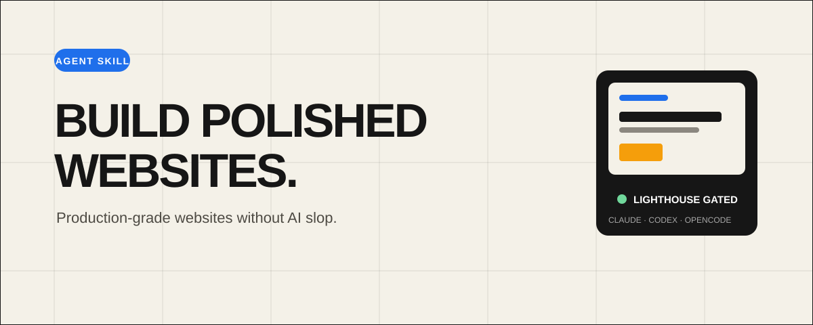
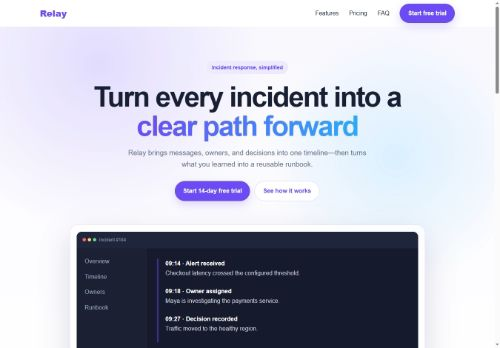
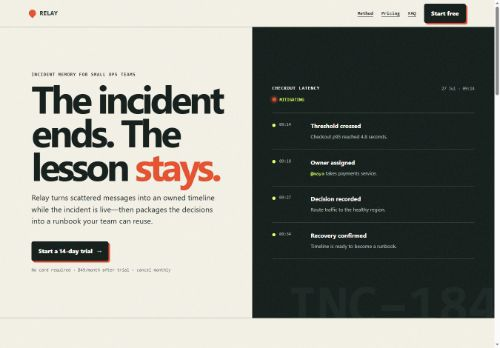

<div align="center">
  

  <h1>Build Polished Websites</h1>

  <p>
    A cross-agent skill for building distinctive, maintainable, production-ready
    websites — without generic AI-generated design patterns.
  </p>

  <p>
    <a href="https://github.com/denfry/build-polished-websites/actions/workflows/ci.yml"></a>
    <a href="LICENSE"></a>
    <a href="build-polished-websites/SKILL.md"></a>
    
  </p>

  <p>
    <a href="https://denfry.github.io/build-polished-websites/"><strong>Live showcase</strong></a>
    ·
    <a href="README.ru.md">Русская версия</a>
    ·
    <a href="#quick-start">Quick start</a>
    ·
    <a href="#supported-platforms">Platforms</a>
    ·
    <a href="#quality-gates">Quality gates</a>
  </p>
</div>

## Why this skill exists

AI can generate a page quickly. It often generates the same page: purple
gradients, floating glass cards, pill-shaped everything, vague copy, invented
metrics, and no evidence that the result works outside a screenshot.

Telling an agent to "avoid AI slop" mostly moves it to the next default: cream
"paper", a terracotta or acid-lime accent, a giant headline with one italic
word, mono uppercase labels, 01/02/03 numbering, and hard offset shadows. It
looks tasteful once and identical across a bakery, a law firm, and a dev tool.

`build-polished-websites` gives Claude Code, Codex, and OpenCode a disciplined
workflow for shipping websites that are:

- art-directed from the subject's own world instead of template-shaped;
- reviewed as screenshots, not only as code;
- native to their CMS or framework;
- maintainable by real content editors;
- responsive and keyboard-accessible;
- reviewed at trust boundaries;
- verified in a browser;
- measured against production Lighthouse reports.

## What it does

The skill guides an agent through the whole delivery loop:

```text
brief → platform contract → archetype → source world → 3 candidate directions
      → direction card → craft → screenshot critique loop (≥ 2 passes)
      → slop scan → browser verification → Lighthouse gate → evidence report
```

It includes:

- an art-direction method: mine the subject's world, compare three candidate
  directions, and commit to a direction card with concrete values;
- a library of twenty direction families (Swiss, editorial, luxury, calm care,
  colour-field, kinetic poster, two-ink print, wayfinding, night hospitality,
  and more) with type, palette, layout, and signature starting points;
- a craft reference: fluid type scales, OKLCH palettes, breakout grids,
  imagery without a photographer, motion, and finishing details;
- a screenshot critique loop with a ten-dimension rubric and blocking defects;
- `snap.mjs`: dependency-free screenshots and contact sheets at four widths,
  plus overflow, console, request, and font checks;
- `slop-scan.mjs`: a detector for first- and second-generation AI design
  fingerprints, stock phrases (English and Russian), and unverified proof;
- platform-aware architecture and editor safeguards;
- WordPress, 1C-Bitrix, Tilda, Shopify, Drupal, Webflow, headless,
  static, and legacy playbooks;
- security and technical SEO checks;
- responsive and manual accessibility verification;
- a deterministic Lighthouse report gate;
- safe installers for all three supported agents.

## Supported platforms

| Platform | Guidance includes |
|---|---|
| WordPress / WooCommerce | Block and classic themes, child themes, Gutenberg, Elementor, ACF, hooks, template ownership |
| 1C-Bitrix | D7, `/local`, components, templates, modules, permissions, component and composite caching |
| Tilda | Standard blocks, Zero Block, custom code, forms, API export, publish-time synchronization |
| Shopify | Liquid, JSON templates, sections, blocks, merchant settings, commerce states, Theme Check |
| Drupal | Custom themes, Twig, libraries, preprocess, render cache metadata, configuration workflow |
| Webflow and hosted builders | Designer ownership, reusable classes/components, CMS bindings, export boundaries |
| Headless CMS | Typed content, preview isolation, webhook verification, cache invalidation, schema evolution |
| Static and legacy sites | Generator-native patterns, output verification, incremental legacy integration |

The agent reads only the relevant platform reference. The main skill stays
compact through progressive disclosure.

## Quick start

Clone the repository:

```bash
git clone https://github.com/denfry/build-polished-websites.git
cd build-polished-websites
```

### Install everywhere

Windows PowerShell:

```powershell
.\install.ps1 -Agent all -Scope user
```

macOS, Linux, WSL, or Git Bash:

```bash
bash ./install.sh --agent all --scope user
```

This installs:

- Claude Code to `~/.claude/skills/build-polished-websites`;
- Codex and OpenCode to the shared
  `~/.agents/skills/build-polished-websites`.

### Install for one project

```powershell
.\install.ps1 -Agent all -Scope project -ProjectPath C:\path\to\project
```

```bash
bash ./install.sh --agent all --scope project --project-path /path/to/project
```

### Install for one agent

Use `claude`, `codex`, or `opencode`:

```powershell
.\install.ps1 -Agent codex -Scope user
```

```bash
bash ./install.sh --agent opencode --scope user
```

Installers never overwrite an existing skill by default. `-Replace` or
`--replace` first moves the current installation to a timestamped backup.

Restart the agent after the first installation if it does not detect the skill
immediately.

## Usage

Mention the skill explicitly:

```text
Use $build-polished-websites to redesign this landing page, preserve the
existing stack, and verify it in the browser and Lighthouse.
```

Claude Code also exposes:

```text
/build-polished-websites
```

The description is designed for implicit invocation, so agents can load the
skill automatically for relevant website and CMS work.

More prompts: [examples/prompts.md](examples/prompts.md).

## The anti-slop standard

The skill does not blindly ban gradients, cards, animation, or fashionable
styles. It requires every visual decision to serve product identity, hierarchy,
content, or interaction.

Avoiding a list of bad patterns produces the next default, so the skill works
from a positive chain instead: a source world, three candidates, a direction
card, and a screenshot review. The fingerprint lists are used to review, not to
generate.

First-generation defaults it catches:

- purple-blue gradient heroes, gradient text, glow blobs, glassmorphism;
- centered badge + headline + two-button layouts and three equal icon cards;
- emoji icons, pills everywhere, fake testimonials, metrics, and logos.

Second-generation defaults it catches:

- cream "paper" grounds with a terracotta or acid-lime accent;
- giant tightly tracked headlines with one coloured or italic word;
- mono uppercase eyebrow labels, 01/02/03 numbering, hard offset shadows,
  page-wide grain, keyword marquees.

Each is allowed when the subject's world actually produces it.

```bash
node build-polished-websites/scripts/snap.mjs ./index.html --gray
node build-polished-websites/scripts/slop-scan.mjs ./src
```

See the complete [visual direction and anti-slop review](build-polished-websites/references/visual-direction.md).

## CMS-safe by design

Before editing, the agent must establish a platform contract:

1. Where custom code belongs.
2. What editors must remain able to change.
3. How generated output and caches are invalidated.
4. How changes reach staging and production.

This prevents edits to WordPress or Bitrix core, avoids patching generated Tilda
exports, keeps Shopify merchant settings usable, and protects the source of
truth in hosted builders and headless systems.

## Quality gates

Run Lighthouse three times per representative production route, then evaluate
the JSON reports:

```bash
node build-polished-websites/scripts/lighthouse-gate.mjs \
  lighthouse-1.json lighthouse-2.json lighthouse-3.json
```

Default median gates:

| Metric | Gate |
|---|---:|
| Performance | ≥ 90 |
| Accessibility | ≥ 95 |
| Best Practices | ≥ 95 |
| SEO | ≥ 95 |
| Largest Contentful Paint | ≤ 2500 ms |
| Cumulative Layout Shift | ≤ 0.10 |
| Total Blocking Time | ≤ 200 ms |

The script fails closed on malformed reports or reports from mixed final URLs.
Lighthouse remains a lab guardrail; field Core Web Vitals are authoritative for
real users.

## Showcase

Live examples: **[denfry.github.io/build-polished-websites](https://denfry.github.io/build-polished-websites/)**.
Three briefs (a Porto bakery, a Gdańsk shipyard festival, a Portland family-law
practice) built twice by the same agent, with the previous and the current
version of the skill, with screenshots, palettes, and `slop-scan` scores. The
pages live in [showcase/](showcase/).

## See the skill difference

The repository includes a controlled
[single-file SaaS comparison](benchmark/saas-single-html/): the same neutral
prompt rendered as a typical unconstrained AI landing page and as a
skill-guided implementation. The included
[comparison report](benchmark/saas-single-html/comparison.md) records the design
differences and three-run Lighthouse medians.

| Without the skill | With `build-polished-websites` |
|---|---|
| [](benchmark/saas-single-html/without-skill.html) | [](benchmark/saas-single-html/with-skill.html) |
| Generic visual defaults · Lighthouse gate **failed** | Product-specific art direction · Lighthouse **100 / 100 / 100 / 100** |

## Repository structure

```text
.
├── build-polished-websites/
│   ├── SKILL.md
│   ├── agents/openai.yaml
│   ├── references/      # archetypes, art direction, directions, craft,
│   │                    # design review, platforms, quality, security
│   └── scripts/         # snap, slop-scan, lighthouse-gate, verify-package
├── benchmark/saas-single-html/
│   ├── screenshots/
│   ├── prompt.txt
│   ├── without-skill.html
│   ├── with-skill.html
│   └── comparison.md
├── examples/
├── install.ps1
├── install.sh
└── .github/workflows/ci.yml
```

The canonical skill follows the Agent Skills progressive-disclosure pattern:
metadata is always visible, `SKILL.md` loads when triggered, and detailed
platform references load only when needed.

## Development

Run all dependency-free checks:

```bash
node build-polished-websites/scripts/verify-package.mjs
node build-polished-websites/scripts/lighthouse-gate.test.mjs
node build-polished-websites/scripts/slop-scan.test.mjs
bash -n install.sh
```

PowerShell syntax check:

```powershell
$tokens = $null
$errors = $null
[void][System.Management.Automation.Language.Parser]::ParseFile(
  (Resolve-Path .\install.ps1),
  [ref]$tokens,
  [ref]$errors
)
$errors
```

CI performs package, Lighthouse-gate, slop-scan, and installation checks on
both Windows and Linux.

## Contributing

Platform corrections, new CMS playbooks, reproducible validation improvements,
and stronger anti-slop heuristics are welcome. Read
[CONTRIBUTING.md](CONTRIBUTING.md) before opening a pull request.

For vulnerabilities, use the process in [SECURITY.md](SECURITY.md).

## License

Licensed under the [Apache License 2.0](LICENSE).
