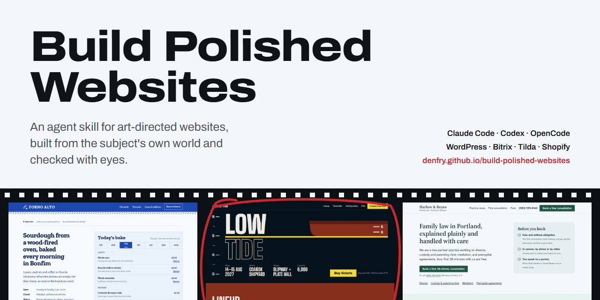
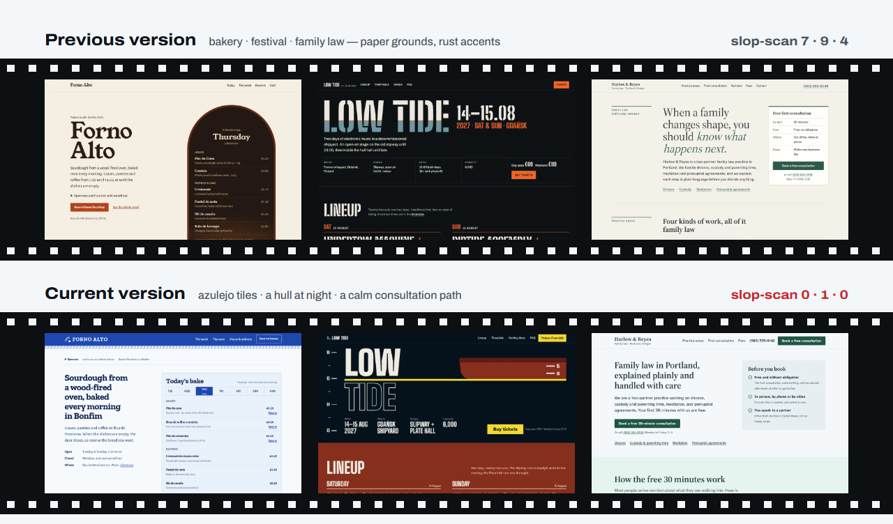

<div align="center">

<a href="https://denfry.github.io/build-polished-websites/"></a>

<p>
  <a href="https://github.com/denfry/build-polished-websites/actions/workflows/ci.yml"></a>
  <a href="https://denfry.github.io/build-polished-websites/"></a>
  <a href="LICENSE"></a>
  <a href="build-polished-websites/SKILL.md"></a>
  
</p>

<p>
  <a href="https://denfry.github.io/build-polished-websites/"><strong>Витрина примеров</strong></a> ·
  <a href="#быстрый-старт">Быстрый старт</a> ·
  <a href="#как-это-работает">Как это работает</a> ·
  <a href="#инструменты">Инструменты</a> ·
  <a href="#платформы">Платформы</a> ·
  <a href="README.md">English</a>
</p>

</div>

**Build Polished Websites** — скилл для Claude Code, Codex и OpenCode. Он учит
агента проектировать и выпускать сайты, которые выглядят как *этот* бизнес, а
не как любой другой, собирать их нативно в WordPress, 1С‑Битрикс, Tilda, Shopify
или на чистом коде и доказывать результат скриншотами, проверками доступности и
Lighthouse.

<a href="https://denfry.github.io/build-polished-websites/"></a>

<sub>Один агент, одни и те же три брифа, две версии скилла. Сами страницы — на <a href="https://denfry.github.io/build-polished-websites/">витрине</a>.</sub>

## Зачем

Агенты делают страницы быстро — и делают одну и ту же страницу. Первое
поколение шаблона всем знакомо: фиолетовые градиенты, стеклянные карточки,
центрированный герой с двумя кнопками, три карточки с иконками, выдуманные
цифры.

Если сказать агенту «избегай AI slop», он переходит ко второму поколению:
кремовая «бумага», терракотовый или кислотно-лаймовый акцент, гигантский
заголовок с одним курсивным словом, моно-надписи капсом, нумерация 01/02/03,
жёсткие смещённые тени. Один раз это смотрится со вкусом, но выходит одинаково
у пекарни, юрфирмы и dev-инструмента. Мы это измерили: наша же прошлая версия
делала именно так.

Список запретов это не лечит: избегать шаблонов — ещё не направление. Скилл
заменяет его решениями, которые агент обязан принять, и доказательствами,
которые он обязан предъявить.

## Как это работает

```text
бриф → контракт платформы → архетип → мир предмета → три кандидата
     → карточка направления → ремесло → критика по скриншотам (2+ прохода)
     → slop-scan → проверка в браузере → Lighthouse → отчёт с доказательствами
```

| Шаг | Что делает агент |
|---|---|
| **Архетип** | Выбирает структуру по намерению посетителя: ресторан «сначала меню», событие «афиша и расписание», путь записи, каталог, документация, дашборд и ещё 12. Никакого «SaaS по умолчанию». |
| **Мир предмета** | Выписывает восемь конкретных вещей из мира бизнеса (плитка, билеты, метки на борту, бланки) и берёт визуальный язык у одной из них. |
| **Три кандидата** | Пишет три направления, различающихся светлотой, жанром шрифта, силуэтом, плотностью или типом изображений, опираясь на 20 семейств направлений и 6 жанровых миров. |
| **Карточка направления** | Фиксирует шрифты, цвета с ролями, сетку, формы, план изображений, движение и один фирменный момент. Значения становятся CSS-токенами. |
| **Ремесло** | Fluid-типографика, OKLCH-палитры, breakout-сетки, лицензионные стоковые фото и видео, непрямоугольные формы, движение и финальная полировка. |
| **Критика** | Снимает страницу на четырёх ширинах, оценивает 10 измерений, исправляет три худших дефекта и повторяет, пока всё не наберёт минимум 4. |
| **Стартовый пакет** | С первой сборкой выпускает SEO, превью для соцсетей и мессенджеров, иконки, микроразметку, robots, sitemap, 404, аналитику с согласием, юридические страницы, рабочие формы и заголовки безопасности. |
| **Проверка** | Клавиатура и фокус, формы и ошибки, консоль и запросы, границы безопасности, SEO-метаданные и медиана трёх прогонов Lighthouse. |

## Быстрый старт

```bash
git clone https://github.com/denfry/build-polished-websites.git
cd build-polished-websites
bash ./install.sh --agent all --scope user        # macOS, Linux, WSL, Git Bash
```

```powershell
.\install.ps1 -Agent all -Scope user              # Windows PowerShell
```

Затем попросите агента:

```text
Используй $build-polished-websites, чтобы сделать сайт семейной пекарни в Казани.
Покажи карточку направления перед вёрсткой.
```

В Claude Code скилл также доступен как `/build-polished-websites` и
подключается автоматически для работы с сайтами.

<details>
<summary><strong>Другие варианты установки</strong></summary>

| Агент | Каталог |
|---|---|
| Claude Code | `~/.claude/skills/build-polished-websites` |
| Codex, OpenCode | `~/.agents/skills/build-polished-websites` |

Только для одного проекта:

```bash
bash ./install.sh --agent all --scope project --project-path /path/to/project
```

```powershell
.\install.ps1 -Agent all -Scope project -ProjectPath C:\path\to\project
```

Только для одного агента: передайте `claude`, `codex` или `opencode` в
`--agent` / `-Agent`. Установщик никогда не перезаписывает существующий скилл;
`--replace` / `-Replace` сначала переносит текущую версию в backup с
отметкой времени. Если агент не увидел скилл, перезапустите его.

</details>

Ещё промпты для редизайна, аудита и каждой CMS: [examples/prompts.md](examples/prompts.md).

## Инструменты

Вместе со скиллом идут четыре Node-скрипта без зависимостей.

**`snap.mjs` — посмотреть на то, что сделано.** Скриншоты на 375, 768, 1100 и
1440 px через локальный Chrome или Edge, читаемый контакт-лист всей страницы
для каждой ширины, а также горизонтальный скролл, ошибки консоли, упавшие
запросы, загруженные шрифты и слишком мелкие кнопки.

```bash
node build-polished-websites/scripts/snap.mjs ./index.html --gray
```

**`slop-scan.mjs` — поймать шаблоны.** Находит приметы шаблонов первого и
второго поколения, штампы на английском и русском («индивидуальный подход»,
«команда профессионалов»), непроверенные «соцдоказательства» и заглушки — с
файлом и строкой. Сигнал — повод обосновать решение или переделать, а не
автоматический провал.

```text
$ node build-polished-websites/scripts/slop-scan.mjs ./src
Score 14: likely generic (0-3 low, 4-7 review, 8+ likely generic).
  [+2] cream-paper x1: cream/beige 'paper' page background
  [+2] mono-eyebrows x6: uppercase tracked mono labels above sections
  [+2] hard-offset-shadow x4: hard offset 'neo-brutalist' shadows
  [+3] fashionable-template: paper background + signal accent + label/shadow grammar
```

**`launch-check.mjs` — выпускать настроенным.** Проверяет собранный сайт на
то, что нужно продакшену с первого дня: title и description, canonical, Open
Graph с абсолютной картинкой превью, иконки и манифест, валидный JSON-LD,
robots.txt, sitemap.xml, страницу 404, один `h1` и `main`, alt и размеры
изображений, пустые и небезопасные ссылки, подписи полей форм и ссылку на
политику рядом с формами, собирающими персональные данные.

```bash
node build-polished-websites/scripts/launch-check.mjs ./dist --base-url https://www.example.com
```

Справочник [launch-essentials.md](build-polished-websites/references/launch-essentials.md)
даёт агенту готовые шаблоны: head, иконки, картинки превью, микроразметка по
архетипам, аналитика и согласие (GDPR и 152-ФЗ), юридические страницы, формы,
которые реально доходят, заголовки безопасности для хостингов, настройка
Яндекс.Вебмастера и Google Search Console.

**`lighthouse-gate.mjs` — держать планку.** Оценивает три JSON-отчёта
Lighthouse на маршрут и проваливает сборку по медиане.

| Метрика | Порог | Метрика | Порог |
|---|---:|---|---:|
| Performance | ≥ 90 | LCP | ≤ 2500 мс |
| Accessibility | ≥ 95 | CLS | ≤ 0.10 |
| Best Practices | ≥ 95 | TBT | ≤ 200 мс |
| SEO | ≥ 95 | | |

```bash
node build-polished-websites/scripts/lighthouse-gate.mjs lh-1.json lh-2.json lh-3.json
```

## Платформы

Агент читает только нужный ему справочник и сохраняет сайт редактируемым для
тех, кто им управляет.

| Платформа | Что покрыто |
|---|---|
| WordPress / WooCommerce | Блочные и классические темы, дочерние темы, Gutenberg, Elementor, ACF, хуки, владение шаблонами |
| 1С‑Битрикс | D7, `/local`, компоненты, шаблоны, модули, права, компонентный и композитный кеш |
| Tilda | Стандартные блоки, Zero Block, свой код, формы, экспорт через API, синхронизация при публикации |
| Shopify | Liquid, JSON-шаблоны, секции, блоки, настройки мерчанта, состояния магазина, Theme Check |
| Drupal | Свои темы, Twig, библиотеки, preprocess, метаданные render cache, конфигурация |
| Webflow и конструкторы | Владение в Designer, переиспользуемые классы и компоненты, привязки CMS, границы экспорта |
| Headless CMS | Типизированный контент, изоляция превью, проверка вебхуков, инвалидация кеша |
| Статика и legacy | Нативные паттерны генераторов, проверка вывода, постепенная интеграция |

Перед правками в CMS агент фиксирует контракт платформы: где живёт свой код, что
должны сохранить редакторы, как сбрасывается кеш и как изменения попадают в
прод. Ядро, вендорный код и сгенерированный экспорт не трогаются.

## Что внутри

```text
build-polished-websites/
├── SKILL.md                     процесс, красные флаги, критерии готовности
├── references/
│   ├── site-archetypes.md       16 архетипов и измерения композиции
│   ├── visual-direction.md      мир предмета, кандидаты, карточка, приметы шаблонов
│   ├── aesthetic-directions.md  20 семейств направлений, 6 жанровых миров, шрифты с кириллицей
│   ├── craft.md                 типографика, цвет, сетки, изображения, сток, формы, движение
│   ├── design-review.md         цикл критики по скриншотам и рубрика
│   ├── launch-essentials.md     SEO, превью, иконки, JSON-LD, согласие, юр. страницы, формы, заголовки
│   ├── quality-gates.md         процедура Lighthouse на продакшене
│   ├── security-seo.md          границы доверия и техническое SEO
│   └── wordpress.md, bitrix.md, tilda.md, shopify.md, other-platforms.md, ...
└── scripts/                     snap, slop-scan, launch-check, lighthouse-gate, verify-package
showcase/                        сайт на GitHub Pages и страницы-примеры
benchmark/                       ранний одностраничный SaaS-бенчмарк
```

## Витрина и бенчмарки

- **[Витрина онлайн](https://denfry.github.io/build-polished-websites/):**
  пекарня в Порту, фестиваль на верфи в Гданьске и семейная юрфирма в
  Портленде — каждая собрана дважды, со скриншотами, палитрами и оценками
  slop-scan.
- **[SaaS-бенчмарк](benchmark/saas-single-html/comparison.md):** один бриф
  инцидент-сервиса без скилла и с первой версией, с медианами трёх прогонов
  Lighthouse.

Три брифа — это демонстрация, а не статистика. Новые брифы и перепрогоны
приветствуются.

## Разработка

```bash
node build-polished-websites/scripts/verify-package.mjs
node build-polished-websites/scripts/lighthouse-gate.test.mjs
node build-polished-websites/scripts/slop-scan.test.mjs
node build-polished-websites/scripts/launch-check.test.mjs
bash -n install.sh
```

CI выполняет эти проверки и оба установщика на Windows и Linux. Витрина
публикуется на GitHub Pages из `showcase/` при каждом пуше в `main`.

## Участие

Приветствуются исправления по платформам, новые справочники для CMS, новые
семейства направлений, более точные приметы шаблонов и воспроизводимые брифы
для бенчмарков. Сначала прочитайте [CONTRIBUTING.md](CONTRIBUTING.md). Об
уязвимостях — по процессу из [SECURITY.md](SECURITY.md).

## Лицензия

[Apache License 2.0](LICENSE)
