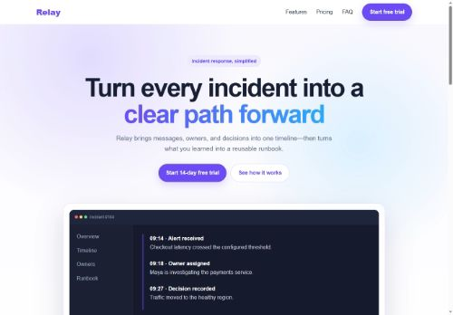
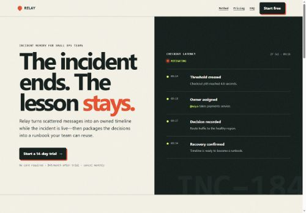

# Single-file SaaS A/B benchmark

This controlled demonstration applies the same product brief to two outputs:

- [`without-skill.html`](without-skill.html) represents a typical unconstrained
  first-pass landing page.
- [`with-skill.html`](with-skill.html) applies the
  `build-polished-websites` workflow and anti-slop review.

The shared input is preserved verbatim in [`prompt.txt`](prompt.txt).

| Without the skill | With the skill |
|---|---|
| [](without-skill.html) | [](with-skill.html) |

## Fairness note

This is an illustrative, reproducible comparison created in one repository. It
is not a blind model benchmark: the two outputs were intentionally art-directed
to expose the decisions the skill changes. Both pages use the same content
requirements, have no dependencies, and are measured with the same tools.

## Visual thesis used only for the skill run

An incident field log: urgent but controlled, with warm operations-manual paper,
signal orange, compressed timeline density, and typographic evidence instead of
generic SaaS decoration.

Adjectives: operational, tactile, decisive. Anti-goal: futuristic dashboard.

## Run locally

From the repository root:

```bash
npx --yes serve benchmark/saas-single-html
```

Then open:

- `http://127.0.0.1:3000/without-skill.html`
- `http://127.0.0.1:3000/with-skill.html`

Lighthouse results and the qualitative comparison are recorded in
[`comparison.md`](comparison.md).
