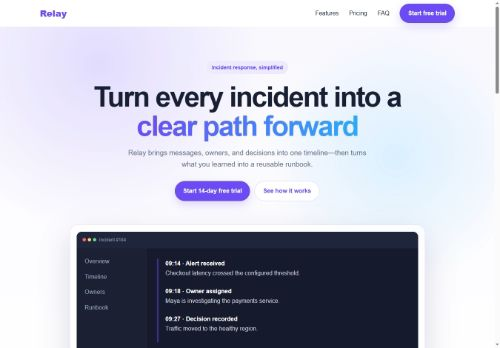
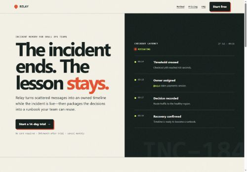

# Comparison: the same SaaS brief with and without the skill

| Without the skill | With `build-polished-websites` |
|---|---|
| [](without-skill.html) | [](with-skill.html) |

## Lighthouse median

Each page was served from the same local Python HTTP server and audited three
times with Lighthouse 13.4.0 in the same installed Chrome. The repository's
default median gate evaluated the JSON reports.

| Variant | Performance | Accessibility | Best Practices | SEO | LCP | CLS | TBT | Gate |
|---|---:|---:|---:|---:|---:|---:|---:|---|
| Without skill | 100 | 94 | 96 | 100 | 752 ms | 0 | 0 ms | **Fail** |
| With skill | 100 | 100 | 100 | 100 | 858 ms | 0 | 0 ms | **Pass** |

The skill version is about 106 ms slower on median LCP because it has a richer
visual system, but it remains far below the 2,500 ms gate. It avoids the
baseline's color-contrast failure and missing-favicon console error.

Lighthouse is lab data, not field Core Web Vitals.

## Qualitative comparison

| Area | Without skill | With skill |
|---|---|---|
| Visual premise | Generic purple SaaS gradient | Product-specific incident field log |
| First screen | Centered badge, gradient headline, two buttons, framed dashboard | Split editorial composition with a live incident timeline |
| Information design | Three equal icon cards | Numbered response loop tied to the actual workflow |
| Copy | Broad phrases such as “respond faster” | Concrete objects: threshold, owner, decision, runbook |
| Components | Pills, floating rounded card, soft shadows | Small-radius controls, ruled sections, evidence-like typography |
| Mobile strategy | Mostly stacks desktop blocks | Re-composes the timeline, steps, pricing, and final CTA |
| Accessibility | Logical headings, but fails contrast gate and has no skip link | Skip link, visible focus, reduced motion, semantic time data, full automated score |
| Browser hygiene | Missing favicon produces a console 404 | Self-contained favicon and no Lighthouse console errors |
| Honest limitations | Generic signup email action | Explicitly labels the placeholder signup action before launch |

## What the skill changed

The main improvement is not “more styling.” The skill introduced decisions
before styling:

1. A visual thesis derived from incident response rather than SaaS fashion.
2. A small token system with a constrained color, spacing, radius, and motion
   vocabulary.
3. Product-specific hierarchy and copy instead of interchangeable feature
   cards.
4. Accessibility and console checks that produced concrete fixes.
5. A three-run median quality gate rather than trusting one Lighthouse run.

## Reproduction

Serve the repository:

```bash
python -m http.server 4173 --bind 127.0.0.1
```

For each page, run Lighthouse three times with unique report paths:

```bash
npx --no-install lighthouse \
  http://127.0.0.1:4173/benchmark/saas-single-html/with-skill.html \
  --output=json \
  --output-path=with-1.json \
  --chrome-flags="--headless --incognito"
```

Evaluate the reports:

```bash
node build-polished-websites/scripts/lighthouse-gate.mjs \
  with-1.json with-2.json with-3.json
```

## Verification limitation

The browser-control surface was unavailable in the session that created this
demo. Lighthouse loaded the correct HTTP URLs in Chrome, but manual screenshot,
keyboard traversal, 200% zoom, and the 375 × 812, 768 × 1024, 1440 × 900, and
awkward-width visual review remain to be performed. The project does not claim
those checks passed.
